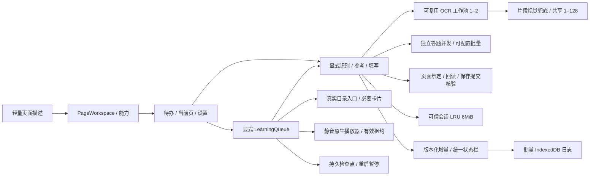

# 0.5.4 实现结构

## 页面工作区与写入权限

`page-workspace.ts` 将已打开用户页面映射为独立工作区，包含账号、课程、任务、tab / frame、绑定版本及 analyze / fill / save / submit 能力。已提交、过期、预览页面仅可分析，不加入待办和批量队列。能力不仅约束按钮，也在后台、任务工作流和内容脚本写入授权处验证。

`task-observer.ts` 只被动读取标题、题数、状态与能力。内容脚本依靠相关 DOM 变化报告轻量描述，取消固定 5 秒完整提取。后台扫描及队列拥有的页面不触发被动处理。显式识别及必要写入核验才完整读取题目；用户打开页面不会启动 OCR、模型或平台保存。

`preparer.ts` 的文字还原和求解可分开调用。参考意图对已有答案也求解，但填写沿用全局保留 / 覆盖策略。任务 ID、题目指纹、已有答案、模型配置、策略、结果版本和有效运行绑定参与复用和写入校验。取消或页面变化后的迟到结果不能合入当前题。

填写、草稿、提交共用 `task-writes.ts`。UEditor 异步操作后再次校验授权，选择题使用真实键。草稿必须读取服务端同任务核对，无法确认显示待确认；提交意图立即持久化，未知结果只核验，不盲目重复提交。

## 识别、缓存和资源释放

`resource-pool.ts` 管理可复用 OCR 资源，硬件逻辑核数较少或初始化失败时降低额度；一份资源的取消不破坏另一份运行。语言资源使用 Tesseract 缓存。参照 [Tesseract 性能说明](https://github.com/naptha/tesseract.js/blob/master/docs/performance.md) 采用工作器复用、有界数量和显式操作时预热，真实 WASM 内存仍需单独测量。

`ocr.ts` 以片段流水线调度：一段 OCR 失败即尝试视觉，不等待整份 OCR。题目原始图片有独立策略，文字和图片并行处理并共用 OCR / 视觉资源。双字号、同分行、置信度、编号填空和括号校验保留。ASCII 等已验证未混淆内容直接保留。

`provider.ts` 的视觉通道为全扩展共享额度，默认 5，最大 128；取得名额后渲染或读取图片，结束释放图像及额度。服务级失败停止本轮未启动请求。答题采用独立全局通道，默认并发 3、每批 5 题，两项可分别配置为 1–50，执行队列优先。`answer-batches.ts` 有界分批，按原题序合并候选，完成数按实际返回累计；失败或取消停止同组后续请求。格式修复与连接测试共用答题名额，页面填写仍按既有顺序执行。

`recognition-cache.ts` 将字体 / 图片实际内容、账号、题目内容、处理版本及实际服务配置参与缓存键。可靠文字与识别证据占 3 MiB，准备结果 / 候选占 3 MiB。两者都在可信会话存储；LRU 优先保留活动页。图片和字体负载不进入持久历史。人工确认按内容指纹保留，模型变更仅使相关候选 / 视觉结果失效。

`inline-symbol.ts` 仅对小幅、连通单字形启用独立字母及数字确认：两次 OCR 均不低于 90 分、结果一致、且不与视觉转录冲突时还原为行内公式。多字形、上标、下标及分式不使用该例外；视觉转录也不得仅因片段短就判为不支持。

`image-materials.ts` 在独立 IndexedDB 保存无法可靠转录的原图，64 MiB 容量、7 天有效期、按最近使用顺序淘汰。准备快照只保存按账号、任务、页面和图片绑定的引用，字体失败等文字问题不会因原图已保存而被清除。`restoreSnapshot` 合并文字与原图材料状态；`provider.ts` 在共享答题名额内读取原图，以带题目及选项对应关系的多模态消息向视觉服务作答。重新作答与一次格式修复都复用已有材料，缺失材料会停止请求。详情页通过本机 Blob URL 预览和下载原图，不公开平台资源地址。

## 增量状态、存储与日志

侧栏首次读取快照，随后应用带 previous / version 的增量字段及记录。版本缺口、焦点恢复或重连重新同步；没有固定 4 秒整份状态轮询。未变化题目和候选维持对象身份，详情分页 20 题，未打开详情及开发者日志不挂载。

普通发布最多每 200 毫秒一次，结束立即发布；普通状态每秒合并保存，提交意图、暂停和最终结果立即保存。写入副本包含当时的页面绑定，不引用之后跳转的页面。界面共用一个每秒时钟。

`journal.ts` 将日志事件和运行元信息批量写入 IndexedDB，250 毫秒或 50 条触发批量，查询、导出和结束时刷新。按完整运行淘汰，7 天 / 100 次已结束运行，活动运行保留。显式允许字段及脱敏规则阻止正文、图片、字体、认证或完整响应进入日志。

操作进度每 5 秒心跳，分别记录最后心跳与实际步骤。传输层只接受有效运行、递增序号及未取消请求；30 秒提示异常，60 秒中止。日志失败不阻塞进度。

## 统一平台访问调度

`background/platform.ts` 保存唯一的 `RequestPacer`，最小派发间隔为 1000ms。计时从实际 fetch / 导航发起时开始，只补足距上次派发不足的时间，首次立即放行；取消且尚未派发的动作不推进时钟。等待前和放行前核对账号、运行、信号及平台暂停状态。

`PlatformReader` 在 offscreen 先查五分钟缓存，未命中才经 `PlatformAdmissionClient` 申请准入。申请立即收到短确认，后台通过独立的检查 / 放行消息派发；HTTP 响应等待不会占用准入回复通道。后台接收实际开始时间，并和标签页导航共用同一个调度器。网络超时从实际派发开始，不把间隔等待算入 30 秒读取超时。

同账号、用途、完整地址及 fresh 语义相同的进行中读取共享结果。订阅者分别取消，最后一个离开才取消真实请求；派发前重新取得当前有效订阅者，首个调用者取消不妨碍其他调用者继续。连续服务器核验使用 fresh，已结束的读取不会被后续核验复用。缓存返回也必须经过后台的账号和拦截检查，不能绕过验证码暂停。

`platformWaitUntil` 仅表示实际调度等待；放行、命中缓存、完成、取消时清除。`readSource` 区分 page / cache / network / shared，`platformRequests` 记录本次运行的主动派发次数。等待开始 / 结束及真实耗时写入脱敏日志，心跳不重复生成历史记录。平台验证码、9010、429、换号或登录失效仍立即停止，无自动重试。

## 学习队列和播放器

`learning.ts` 保存所选课程、范围、题目目标及逐项检查点。目录入口来自真实页面的 `learning-parser.ts`，兼容现代目录 iframe、`toOld(...)` 及同页 / 新标签页导航。`chapter-access.ts` 监听真实导航取得卡片地址，不拼猜参数；仅拥有学习页面，清理自己捕获的章节标签页。自动刷新范围保持课程汇总和普通作业列表。

`learning-card-reader.ts` 只读取已绑定文档的 HTML，核对账号、课程、章节、分页和当前 documentId；快照不持久化。当前分页身份匹配时不重复点击，解析已有 HTML 后无需网络补读。资源启动先打开或复用拥有的卡片页，再检查该页面的任务；快照失效时仅补读一次。恢复或页面失效需要重新导航时仍由共享调度放行。完成核验不使用快照或缓存，最多三次最新服务器读取，没有额外固定睡眠。

资源启动检查确认已完成时，`process` 立即继续队列循环，推进当前索引；不能在此等待播放 / 阅读事件，因为已完成资源未启动播放器。实际启动资源才进入事件等待，全部完成则结束。回到循环时继续检查账号、暂停与取消，迟到旧资源事件不能推进另一项任务。

视频由 `video-player.ts` 使用原生播放事件跟踪。开始需账号、任务、对象及运行绑定；静音、1 倍速，无跳播、伪造任务点或额外上报接口。内容脚本 5 秒心跳向后台续租，60 秒失去有效租约暂停；普通恢复第一次保持有效绑定原地播放 / 加载媒体，第二次重新加载卡片。恢复确认必须观察真实播放位置前进，空地址的临时重载不等于换源，实际换源或播放器替换重新绑定。发现阶段拥有的页面会停止未授权自动播放。

`reader-view.ts` 只探测当前任务容器，支持静态页、原生分页、PDF.js 和可确认的滚动区；外层工具栏与包含实际阅读 iframe 的容器不作为第二个阅读器。`ReadingAdapter` 将动作节奏、最多 250ms 的局部检查和 5 秒心跳拆开。滚动验证真实位移及懒加载高度，底部稳定 1 秒后本地结束。`LearningSettings` 采用 1000ms 默认及 250–5000ms 严格整数校验，reader-start 使用资源启动快照；独立保存不改变识别配置版本或候选缓存。

`learning-completion.ts` 对任务配置、自己的容器标记和目录图标 / 待完成数量建立确认、未完成、未知、冲突状态。兄弟及嵌套资源不提供本任务证据；零数量、播放或翻阅结束不证明完成。fresh 同任务服务器配置优先于旧页面文字，无法解决的冲突为待确认。恢复队列先重新核对真实目录中的稳定章节标识，再读取目标卡片，丢弃旧 document / frame / lease。

`play()` 成功只表示播放请求已接受，不代表任务点完成，依据 [播放 API 文档](https://developer.mozilla.org/en-US/docs/Web/API/HTMLMediaElement/play)。ended 后按平台间隔读取真实任务点；未知完成状态为待确认。播放受阻、停滞、验证码、限流、换号和登录失效暂停。

章节题复用已有执行队列。背景视频允许当前页参考，章节题等待手动参考结束；当前页写入前等待学习及执行在安全阶段暂停。学习及执行队列重启均暂停，采用事件和持久检查点适应 [MV3 后台生命周期](https://developer.chrome.com/docs/extensions/develop/concepts/service-workers/lifecycle)。

## 升级

schema 保持 2，新增字段补默认值；workflow 处理版本 6、页面文字指纹版本 8。保留模型配置、正式历史及通知记录，开发者模式默认关闭。旧学习队列暂停并移除页面绑定和旧目录快照；当前工作区与识别证据是会话数据，正式执行及学习检查点持久保存。
